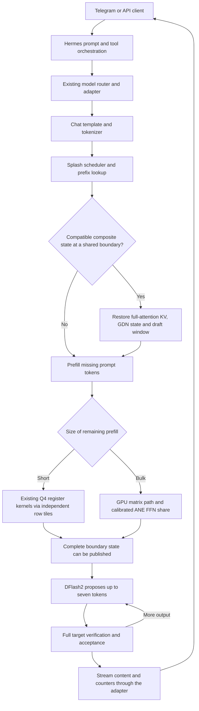

# Architecture audit — 10 October 2026

> Historical heuristic study. The implemented cost-aware extension and newer results are in [the planner article](semantic/ARTICLE.md). These are separate experiments.

## Assessment

There is useful work to contribute, especially to Splash's first-branch state placement. The evidence does **not** establish that this installation is ahead of every engine, kernel, or runtime. It is an optimized integration of upstream model and runtime technology, with a few local source changes and a substantial improvement in a specific latency failure.

This audit reads public sources at the exact revisions in `data/public-revisions.json`. It reuses saved measurements; it performs no new inference benchmark and makes no production changes.

## What belongs to whom

| Layer | Upstream foundation | Local contribution | Assessment |
|---|---|---|---|
| Target model | Qwen hybrid architecture, trained weights, affine quantization | Selection and deployment of the uncensored Q4 checkpoint | No new model architecture, training, or intelligence gain established |
| Native execution | Splash C++ scheduler, Metal kernels, memory planner, composite state, APIs | Proactive final-user-turn checkpoint policy | Useful localized engine contribution; related boundary techniques already exist elsewhere |
| Short prefill | Existing Q4 eight-row register kernels | A distinct `RegisterPrefill` host phase, 8–128 independent rows, occupancy and scratch accounting | Local scheduling contribution; no new deployed Metal arithmetic kernel |
| Bulk prefill | Stock matrix tiles and ANE FFN implementation | Opt-in tile dispatch and calibration-policy identity/remeasurement | Small measured whole-path effect; universal superiority not established |
| Speculation | DFlash2 trained draft, learned selector, target verification | Preserve its complete context at an earlier reusable composite boundary | Less draft setup work; sustained draft-policy improvement not demonstrated |
| Earlier native TensorFold path | TensorFold 0.6.5 / MLX fragment kernels and draft shortlists | Direct indexed draft weight-row addressing, stable tokenized message spans, reuse-aware checkpoint eviction, draft snapshot sidecar | Practical memory/cache adaptations; partly superseded or requiring a port to current TensorFold |
| Agent and remote API | Hermes, OpenAI-compatible serving, existing tool validation | Routing, streaming, client compatibility, tool-call delivery repair, bounded/lazy auxiliary resources | Integration work rather than a new inference architecture; no fresh end-to-end latency measurement in this audit |

The installed enhanced 27B path and the older TensorFold/MLX tuning path are alternatives. Their gains cannot be added together as if every optimization runs inside one decoder. In particular, the historical indexed draft head is not part of the measured Splash kernel path.

## How the measured path works

The target has 64 dense layers: 48 GatedDeltaNet layers and 16 full-attention layers. An earlier prefix's attention KV is insufficient to roll back recurrent state. The recurrent tensors and the draft's 2048-token window must represent the same verified token boundary. Splash already supplies that composite-state machinery; the local change schedules an additional useful boundary.

Previously, the final replay state could include the old question, so a sibling question diverged before it. A disposable progress checkpoint sometimes survived at 4096 tokens and sometimes had already been reclaimed. The local policy scans for the final tokenizer-verified user header, rounds its position down to the 32-token page grid, and asks Splash to publish an ordinary non-disposable composite state there. It requires at least 2048 tokens of potential reuse beyond the resume point. Existing prefix/image identity checks, allocation admission, eviction and memory limits still determine whether it can be reused.

The marker is a placement hint, not a cache identity or permission to reuse state. A literal marker in content might reduce placement quality, but it cannot authorize a mismatching prefix. A frontend-supplied, tokenizer-derived message span would be a better upstream interface than a model-specific environment marker.

## Current public comparisons

These are feature/source comparisons, **not** speed rankings.

| Project / source inspected | Relevant current behavior | Consequence for a novelty claim |
|---|---|---|
| [Splash engine](https://github.com/incoai/splash/blob/8a2b42069923d483151372b615f6182c72c2b6cd/runtime/engine/Engine.cpp) | Composite states, configurable progress checkpoints, lazy junctions and shared active-prefill boundaries | We extend an existing cache architecture. The inspected planner has no final-user-header proactive anchor |
| [Splash kernel policy](https://github.com/incoai/splash/blob/8a2b42069923d483151372b615f6182c72c2b6cd/runtime/ops/LinearGguf.cpp) | Current formats and dispatch differ from our legacy affine implementation; short prefill already has a staged route | Our `RegisterPrefill` diff is a historical measured implementation, requiring a format-aware port and new qualification |
| [TensorFold 1.0.4](https://github.com/ashhart/TensorFold/blob/63bef1260f1172058fbca0aeab13366d9b67373c/README.md) | Native Zig Metal/CUDA serving; Python 0.6 continues separately | The installed 0.6.5 integration is not current main. No inference comparison against this native revision exists here |
| [TensorFold prompt cache](https://github.com/ashhart/TensorFold/blob/63bef1260f1172058fbca0aeab13366d9b67373c/zig/src/core/prompt_cache.zig) | `beginRewind` / `lookupRewind` explicitly keep state before the latest user message, under the cache budget | A very close existing implementation of the central placement idea |
| [llama.cpp server](https://github.com/ggml-org/llama.cpp/blob/781dbc5ac98921dbdb5e5b2ec5b7a50960e937d4/tools/server/server-context.cpp) | Checkpoints at message starts, special handling for the latest user message, saved speculative draft state | Conversation-boundary checkpointing and target/draft co-restoration are existing techniques |
| [oMLX prefix cache](https://github.com/jundot/omlx/blob/013bc3f3a48fa9a4b7dffbfeb6cdc7c1face1c5d/omlx/cache/prefix_cache.py) and [release notes](https://github.com/jundot/omlx/releases) | Recurrent boundary snapshots, exact/partial prefix reuse and reusable speculative draft state | Hybrid and draft-state caching are not unique to our stack |
| [oMLX ANE prefill](https://github.com/jundot/omlx/blob/013bc3f3a48fa9a4b7dffbfeb6cdc7c1face1c5d/docs/experimental/qwen35_ane_prefill.md) | Calibrated ANE/GPU execution with precision-sensitive boundaries | We did not invent ANE prefill or heterogeneous scheduling |
| [MLX-LM cache primitives](https://github.com/ml-explore/mlx-lm/blob/ba8a08fd2ed72bbc53de84f89933f91fe4743e4a/mlx_lm/models/cache.py) | Attention cache trim support and separate recurrent `ArraysCache` state | Useful primitives, not evidence that every server built on MLX-LM lacks or has our policy |
| [vLLM Mamba manager](https://github.com/vllm-project/vllm/blob/c41b2639e29c3bc01add1d34bef3032a6d9d8aca/vllm/v1/core/single_type_kv_cache_manager.py) | Align-mode checkpoints, shared-prefix boundaries and retention-aware state publication | Composite hybrid prefix reuse is established in larger serving systems too |

The pinned vLLM design document still describes Mamba prefix caching as work in progress, while its pinned implementation contains a Mamba checkpoint manager. This audit gives the actual implementation precedence over stale documentation. An RFC alone would not establish that a technique is shipped.

[Marconi](https://arxiv.org/abs/2411.19379), published before this local work, describes hybrid prefix caching and reuse-aware admission/eviction. This is directly relevant prior art for both proactive state placement and the earlier local reuse-aware eviction adapter. This audit is not an exhaustive novelty or patent search.

## What the evidence supports

| Measured behavior | Stock median | Enhanced median | Interpretation |
|---|---:|---:|---|
| First changed 8K follow-up, normal cache pressure | 27.5605 s | 0.4271 s | 64.5× lower TTFT in seven pairs; reuse 0 → 8192 |
| Earlier rebuilt control, 4K checkpoint retained | 14.599 s | 0.602 s | Three-pair screen; shows the fix is not solely the result of a completely evicted stock prefix |
| Exact repeat 8K | 0.3226 s | 0.2068 s | 1.56× lower TTFT for the complete enhanced preset |
| New uncached 8K prompt | 27.0814 s | 26.5741 s | 1.87% lower median; fixed ordering and n=7 limit causal certainty |
| Changed-turn target prefill | 8238–8239 rows | 46–47 rows | Avoided work explains the latency change |
| Changed-turn draft context materialization | 4128 rows | 32 rows | 129× fewer setup rows, not 129× faster decoding |

All seven changed-turn answers and seven repeat answers are byte-identical between arms. Across the entire 49-pair qualification, 28 outputs match exactly. Different tiling/reduction order can change greedy output, so the complete preset is not established as bit-identical across all prompts.

Enhanced sustained effective decoding is approximately 33.82 tok/s for new English, 26.70 for new Arabic, and 79.40 for new Python in this corpus. Draft acceptance is 19.04%, 11.43% and 60.60% respectively. These numbers do not demonstrate a general sustained-speed or intelligence improvement over stock. The Python semantic check passes in 0/7 cases in each arm despite successful syntax checks; the common error is an import placed in class scope and used as an unqualified global.

Sampled process-family peak is 25.50 GiB across qualification, swap remains zero, and sampled pressure is normal. Sampling is every 0.5 s; it can miss instantaneous peaks and process-family sums can overlap shared accounting. No GPU clocks or die temperatures were measured. Short 16-token latency probes are not sustained-generation benchmarks.

## What to share

1. A small Splash proposal for proactive reusable state placement before the latest user turn. Include source, the actual cache/target/draft counters, both cache-pressure conditions and close prior art.
2. An M4 short-prefill scheduling case study, with the exact historical patch chain and a clearly unqualified port to today's changed quantized kernel layout deferred to upstream collaboration.
3. A secondary TensorFold draft-head memory proposal: direct selected-row addressing avoided 401,264,640 bytes (382.7 MiB) of duplicate weights in the older implementation. Fourteen selected-head numerical checks passed. Two repetitions per domain showed modest throughput differences, insufficient for a broad speed claim.

The contribution can be valuable without being a new algorithm: a narrowly scoped implementation closes a real usability failure and carries unusually explicit evidence about avoided work, failed alternatives and timing boundaries.

## What remains unestablished

No current public runtime performance ranking, quality/intelligence superiority, universal zero-regression claim, new fundamental model architecture, new DFlash algorithm, or global originality is established. The qualified host build reused an existing compiled archive; the nearby source commit alone does not certify all unchanged translation units. The original checkpoint's exact remote revision is not independently certified in this package.

The next research opportunity is exposing semantic message boundaries to the native planner, using measured snapshot cost and reuse likelihood to prioritize them, and preserving the complete target/draft state contract. At the time of this original audit these were proposed extensions. The later [cost-aware planner study](semantic/README.md) implements measured-cost user-boundary placement; frontend tool/document spans and global eviction opportunity cost remain future work. Public engines already address parts of that problem; improvements should be presented and evaluated as an extension of that work.
